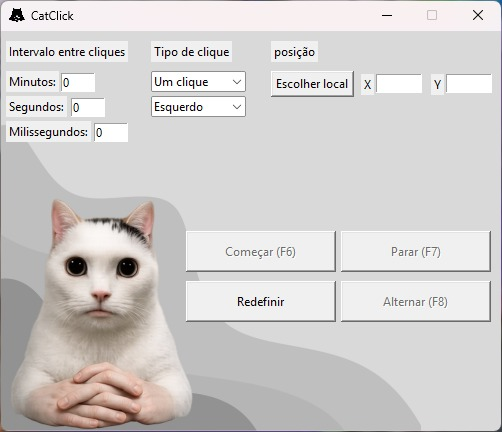
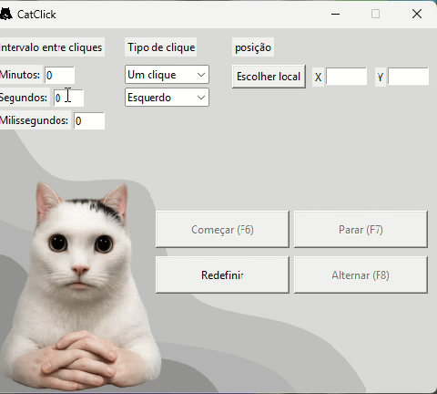
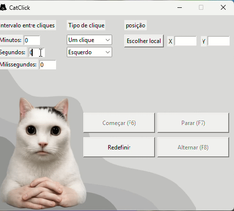

# CatClick

## O que é o CatClick

O Catclick é uma aplicação desktop de automação. O catclick é um software para Windows destinado a automatizar cliques para facilitar tarefas repetitivas, o software é bem intuitivo e possui uma interface simples possibilitando com que seja mais fácil de utilizar, além de sua funcionalidade de cliques automáticos, o software conta com atalhos facilitando o uso, localização através do mouse e intervalos editaveis. 

## Funcionalidades  

As funcionalidades atuais são extremamente simples. As funcionalidades do projeto seguem uma linha bem simples, interface > automação, as funções giram em torno desse fluxo simples, para melhor compeensão juntei as funcionalidades principais, exemplos e resumos breves do que elas fazem:

- Automação:

    - Cliques automáticos: Automação de tarefas que envolvem cliques repetitivos atráves da biblioteca PyAutoGUI e Keyboard;
    - Controle por teclado: A aplicação permite o uso do teclado para parar, iniciar ou alternar a ativação dos cliques;
    - Configurações de intervalo: A plataforma permite colocar intervalos entre os cliques, possibilitando cliques otimizados de acordo com sua necessidade.

        
        

- Interface:

    - Interface simples: A interface gráfica do CatClick possui um design extremamente simples, facilitando o uso do software;
    - Localizar pontos específicos: A aplicação permite através do mouse ou coordenada determinar a área onde o autoclick atua.

        

## Blibliotecas utilizadas

- Tkinter
- PyAutoGUI
- Keyboard
- Pynput

## Estrutura

A estrutura do projeto procura a facilidade na manutenção continua da aplicação e a separação de funções para melhor entendimento. Os arquivos e pastas dentro da estrutura por si só permite a navegação entre a estrutura, porém algumas estruturas podem não ser famíliares, portanto é importante dar enfâse na estrutura atual completa, os dois `assets` guardam todos os materiais necessários para aplicação e para o README.md, a pasta `src` guarda os módulos e a pasta assets da aplicação, o arquivo `.gitgnore ` bloqueia arquivos de cache ou venvs, o arquivo `main.py` é o arquivo pai que inicia toda aplicação, o `README.md` é responsável por resumir o projeto e por último o arquivo `requirements.txt` guarda todas as bibliotecas necessárias para rodar o projeto.

- assets/
- scr/
    - catclick/
        - assets/
        - automacao.py
        - interface.py
- .gitignore
- main.py
- README.md
- requirements.txt

## Instalação

1. Clone o repositório https://github.com/uellpng-tech/catclick;
2. Acesse a pasta do projeto "src" e depois "catclick";
3. Crie um ambiente virtual python3 -m venv venv (opcional);
4. Ative o ambiente virtual "venv\Scripts\activate";
5. Instale as dependências "pip install -r requirements.txt";
6. Execute o programa "python main.py".